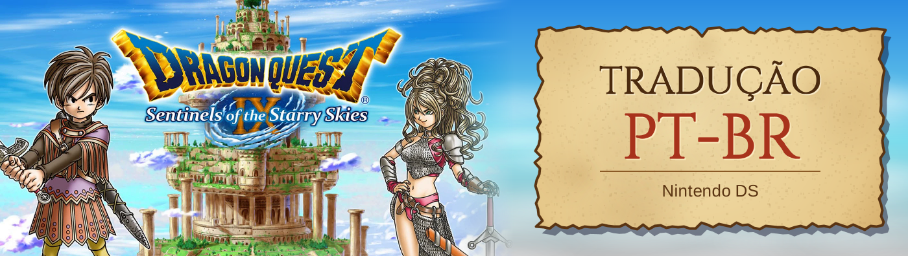
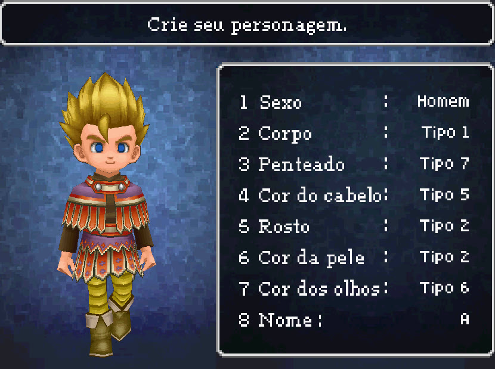
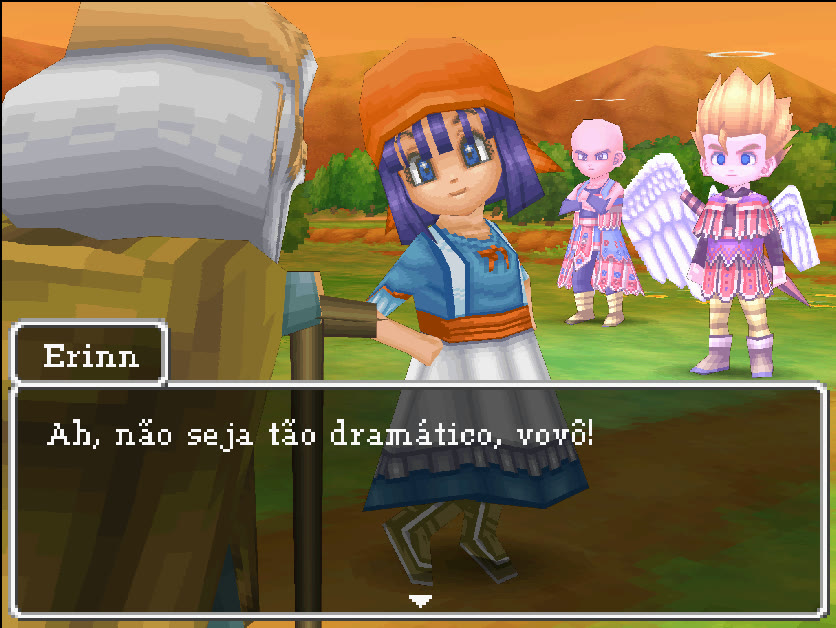
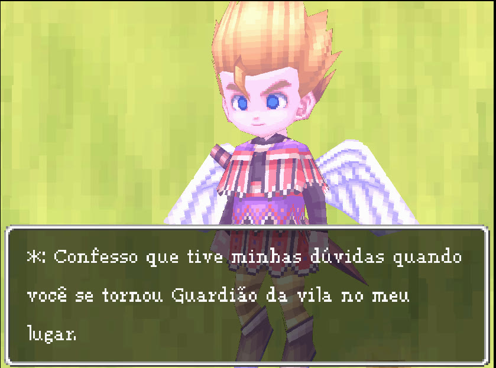
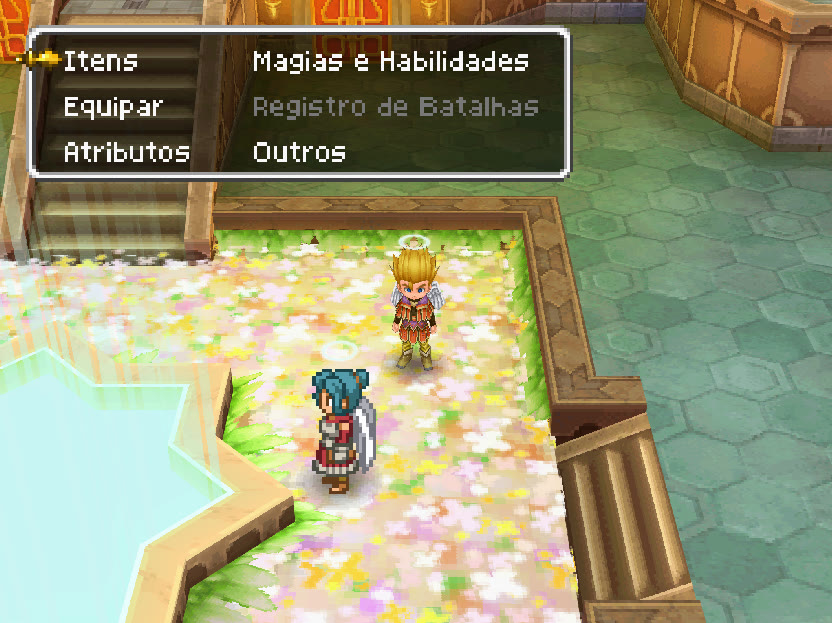

# ⭐ Dragon Quest IX: Sentinels of the Starry Skies (DS) — Tradução PT-BR

-009c3b)

Tradução de fã do **Dragon Quest IX: Sentinels of the Starry Skies** (Nintendo DS, versão americana).
**Tradução completa para o português do Brasil**, com menus, história, diálogos, missões, magias, itens,
monstros, lugares e imagens com texto em português.

*Feita por fãs, para fãs. Gratuita, sem fins lucrativos e sem nenhuma ligação com a Square Enix ou a Nintendo (veja o
aviso legal no fim desta página).*

> ✅ O jogo inteiro está traduzido. Se achar algum problema, abra uma [issue](../../issues).

## 🖼️ Imagens

| | |
|---|---|
|  |  |
| Tela de início | Criação de personagem |
|  |  |
| Diálogo da história | O Guardião da vila |
|  |  |
| Batalha: comandos e táticas | Menu principal |

## 📥 Download

**[⬇️ Baixar a tradução](../../releases/latest)** (página da versão mais recente). Dentro do zip vem o patch (`.xdelta`)
e um guia `LEIA-ME.txt`. Como aplicar: veja **💾 Instalação** abaixo.

## 🎮 O que foi traduzido

| Parte | Textos diferentes | Cobertura |
|---|---|---|
| História, falas de todas as cidades, as 184 missões (inclusive as extras que já vêm no cartucho), livros, placas e os comentários da Stella | 12.886 | 100% |
| Menus, batalha, lojas, alquimia, pousada, títulos, bestiário, descrições e nomes das grutas dos mapas do tesouro | 6.885 | 100% |
| Nomes de itens, magias, habilidades, vocações e monstros | 1.838 | 100% |
| Imagens com texto (tela de início, criação de personagem, telas de menu, carimbos das missões, efeitos da batalha) | 74 arquivos | 100% |

- **Tudo a partir do inglês**, a versão cheia de humor britânico, sotaques e nomes com trocadilhos, conferido com o
  **japonês** para entender quem fala com quem, o gênero e a intenção de cada fala. Quando o inglês faz piada, a piada
  foi recriada em português em vez de traduzida ao pé da letra.
- **Cada personagem fala do seu jeito:** a Stella xinga com "asa" (*"raios de asa!"*), o Sterling fala solto, os
  sotaques regionais do inglês viraram sotaques leves do Brasil (Pedravia gaúcha, Zere mineira, Porto Llaffan
  nordestino, Riacho da Losna carioca), e os convidados da Pousada que vêm de outros Dragon Quest falam como nos seus jogos.
- **Gênero do herói:** as falas concordam com o herói ou a heroína (*"bem-vindo/bem-vinda"*, *"Guardião/Guardiã"*).
- **Medidas no lugar:** todo texto foi medido pixel a pixel para caber nas caixas de fala (3 linhas) e nos menus do DS.
- **Interface:** PV/PM/Nv no lugar de HP/MP/Lv, moeda com "O" de ouro, artigos e gênero corretos nas mensagens de
  batalha e nomes das grutas na ordem natural do português (*"Caverna de Granito da Desgraça"*).

### Alguns exemplos

- **Magias:** *Frizz/Kafrizz/Kafrizzle → Fogo/Megafogo/Gigafogo · Zam/Zammle/Kazam → Treva/Supertreva/Megatreva*.
  Mesmo padrão base < Super < Mega < Giga da nossa tradução do Dragon Quest VIII.
- **Monstros:** traduzidos, com graça (*Dracky → Draculino · Cruelcumber → Pepinferno · Manguini → Bocarrini*);
  Slime fica, porque já é palavra usada em português.
- **Lugares com trocadilho:** recriados (*Coffinwell → Covalinda · Stornway → Pedravia · Swinedimples → Porcoverrugas ·
  Wormwood Creek → Riacho da Losna · The Gittish Empire → Império Brutânico*).
- **Personagens com trocadilho:** *Mayor Laria → Prefeito Malário · Al Capinne → Al Pousone ·
  Grandmaster Wun Tun Punch → Grão-Mestre Yakissoco*.

## 🚫 O que não foi traduzido (de propósito)

| O quê | Por quê |
|---|---|
| Nomes próprios (Stella, Aquila, Erinn, Zere, Gleeba, Apus Major…) | São nomes, iguais em todas as versões do jogo. |
| Logotipo do título e copyright | Arte e marcas registradas. |
| Créditos (cargos e nomes da equipe) | Ficam como no original. |
| Falas em francês da Fleurette e da Madame Couteau, em italiano do Morrie e em alemão do Doktor Münster | De propósito, como no original (o sotaque é a piada). |
| DQVC | Nome da loja especial. |
| Slime | Nome de monstro que já é palavra usada em português. |
| Teclado de nome sem ã/õ | O teclado do jogo original não tem essas letras (limitação do jogo). |

## 💿 O que você precisa

Você precisa da sua **própria cópia** do jogo, versão **americana (USA)**. **Este projeto não distribui o jogo.**

Confira se a sua ROM é a certa (`.nds` sem modificação):

| | |
|---|---|
| CRC32 | `AACE5E9C` |
| MD5 | `ce8a56bc94f53d7841475edc308b0421` |
| SHA-1 | `c7c3014c237900c8281289b8bc76a781969b6278` |
| Tamanho | 268.435.456 bytes (256 MB) |

## 💾 Instalação

Aplique o `.xdelta` na sua ROM americana. O resultado é uma ROM nova; guarde a original.

- **🌐 No navegador (mais fácil):** abra o [Rom Patcher JS](https://www.marcrobledo.com/RomPatcher.js/), escolha a sua
  ROM em *ROM file*, o `.xdelta` em *Patch file* e clique em *Apply patch*. Funciona no PC e no celular.
- **🖥️ No PC:** use o [Delta Patcher](https://github.com/marco-calautti/DeltaPatcher) (Windows, Linux, macOS) ou o
  `xdelta3` na linha de comando:
  `xdelta3 -d -s "Dragon Quest IX (USA).nds" DQ9_PTBR.xdelta "DQ9_PTBR.nds"`
- **🎮 Onde jogar:** em qualquer emulador de DS (no melonDS, se o PC permitir, ligue o **JIT** em *Config → Emu
  settings → CPU emulation* para a emulação ficar mais rápida) ou num DS/3DS com flashcard ou TWiLight Menu++.
- **Para atualizar** a partir de qualquer versão anterior (inclusive a antiga Nomes Originais), aplique o patch novo na
  **ROM americana original**, não na ROM traduzida antiga.

Saves do jogo em inglês e das versões anteriores funcionam normalmente.

## 🔒 Segurança

- Baixe a tradução **só pela página de [Releases](../../releases) deste repositório**.
- Faça backup do seu save antes de jogar.

## ❓ Não funcionou?

| Sintoma | Causa provável |
|---|---|
| O patcher diz que o arquivo não confere | A ROM não é a americana sem modificação (ou já é uma ROM traduzida). Confira o CRC32/MD5 acima. |
| Textos misturados depois de atualizar | Você carregou um *save state* feito com a versão anterior. Feche o jogo e continue pelo save normal. |
| Travamento ou tela preta | Abra uma issue informando onde aconteceu. |

## 🐞 Achou um erro?

Abra uma [issue](../../issues/new/choose) usando o formulário "Erro na tradução". Informe a versão do patch, o lugar do jogo e, se puder, mande um print. Toda correção de português também é bem-vinda.

## 🙏 Créditos

- **Tradução, revisão e ferramentas:** [0xdhx0](https://github.com/0xdhx0).
- **Documentação dos formatos do jogo:** projeto [DQIX](https://github.com/DQIX) (DQI-haX).
- **Fontes livres** usadas no banner: Cinzel e Arimo (licença OFL).

**Como foi feita:** a tradução usou ferramentas de IA. Todo o texto foi traduzido a partir do inglês e conferido com o
japonês, com o contexto da história e o jeito de falar de cada personagem, medido pixel a pixel para caber na tela e
testado no jogo. Se achar uma frase estranha, abra uma [issue](../../issues), porque toda sugestão ajuda.

## ⚖️ Aviso legal e uso

- Esta é uma **tradução feita por fãs, para fãs**, **gratuita** e **sem fins lucrativos**.
- **Não temos nenhuma ligação** com a Square Enix, a Nintendo ou qualquer outra empresa envolvida no jogo. O projeto não
  é oficial, nem aprovado ou apoiado por elas.
- *Dragon Quest IX: Sentinels of the Starry Skies* e todos os nomes, marcas e personagens pertencem aos seus donos
  (© ARMOR PROJECT/BIRD STUDIO/LEVEL-5/SQUARE ENIX, © KOICHI SUGIYAMA).
- O pacote contém **só o patch (`.xdelta`)** com as diferenças da tradução e **não funciona sem uma cópia do jogo
  original**. O jogo não é distribuído aqui: não peça nem compartilhe ROMs (`.nds`) neste repositório.
- Pode usar e compartilhar o patch à vontade, **de graça**. Ele **não pode ser vendido** nem monetizado. Se alguém
  cobrou por ele, você foi enganado. Veja [LICENSE.txt](LICENSE.txt).
- Se você é detentor de algum direito e quer que algo seja retirado, abra uma issue ou entre em contato pelo GitHub.

Apoie a franquia comprando os jogos oficiais.
