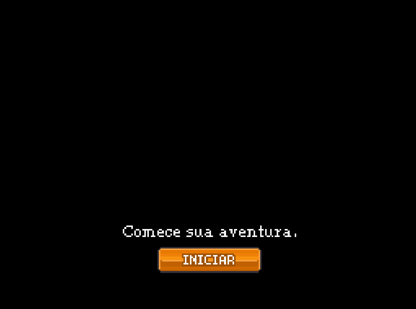
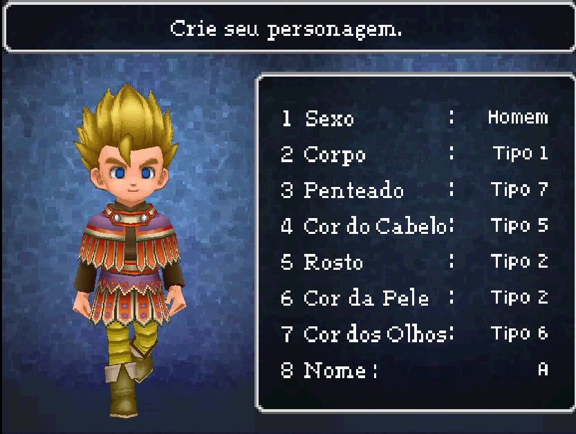
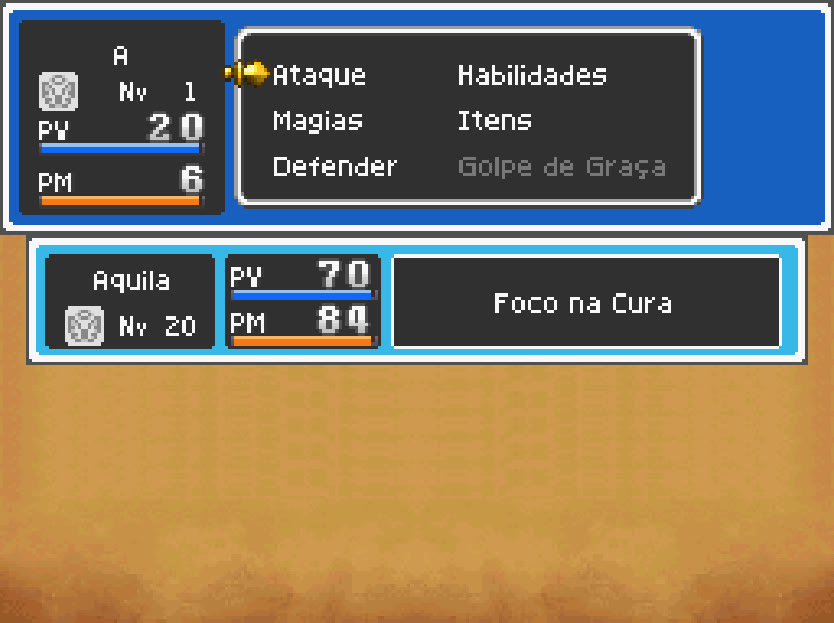

# ⭐ Dragon Quest IX: Sentinels of the Starry Skies (DS) — Tradução PT-BR v1.1

-009c3b)

Tradução de fã do **Dragon Quest IX: Sentinels of the Starry Skies** (Nintendo DS, versão americana) para o
**português do Brasil**.

*Feita por fãs, para fãs. Gratuita, sem fins lucrativos e sem nenhuma ligação com a Square Enix ou a Nintendo (veja o
aviso legal no fim desta página).*

> ✅ O jogo inteiro está traduzido: história, falas de todas as cidades, as 184 missões (inclusive as extras que já vêm
> no cartucho), menus, itens, magias, habilidades, monstros, nomes das grutas dos mapas do tesouro, os comentários da
> Stella e as imagens com texto. Testado no emulador melonDS. Se achar algum problema, abra uma [issue](../../issues).

> 🇯🇵 **Traduzida com duas visões do texto desde o começo**: o inglês como base (sentido, piadas e sotaques da
> localização) e o **japonês original** para acertar gênero e plural de quem fala, com quem fala e o que o inglês deixa
> ambíguo.

## 📸 Fotos

<table>
<tr>
<td align="center"> Tela de início</td>
<td align="center"> Criação de personagem</td>
</tr>
<tr>
<td align="center"> Diálogo da história</td>
<td align="center"> O Guardião da vila</td>
</tr>
<tr>
<td align="center"> Batalha: comandos e táticas</td>
<td align="center"> Menu principal</td>
</tr>
</table>

## 📥 Download (v1.1)

**[⬇️ Baixar `DQ9_DS_PTBR_v1.1.zip`](../../releases/latest)**: os dois patches (`.xdelta`), o guia `LEIA-ME.txt` e os
termos de uso.

| Dentro do zip | O que é |
|---|---|
| `DQ9_PTBR_NomesTraduzidos.xdelta` | Versão Nomes Traduzidos (tudo em português) |
| `DQ9_PTBR_NomesOriginais.xdelta` | Versão Nomes Originais (igual à Nomes Traduzidos, mas com os nomes que se procuram num guia e as imagens como no original) |

## 🎭 Duas versões: escolha a sua

| | **Nomes Traduzidos** | **Nomes Originais** |
|---|---|---|
| Menus e telas | Português | Português |
| História, diálogos, missões e mensagens | Português | Português |
| Descrições de itens, magias, habilidades e monstros | Português | Português |
| Piadas, sotaques e trocadilhos dentro das falas | Recriados em português | Recriados em português |
| Magias, habilidades e golpes | Português (*Fogo, Megafogo, Gigafogo, Ressuscitar*) | Originais (*Frizz, Kafrizz, Kafrizzle, Zing*) |
| Vocações | Português (*Menestrel, Armágico, Astro*) | Originais (*Minstrel, Armamentalist, Luminary*) |
| Itens, armas e equipamentos | Português (*Erva Medicinal, Asa de Quimera, Espada de Cobre*) | Originais (*Medicinal Herb, Chimaera Wing, Copper Sword*) |
| Monstros, inclusive chefes | Português (*Draculino, Pepinferno, Slime Metálico*) | Originais (*Dracky, Cruelcumber, Metal Slime*) |
| Cidades, mapas e grutas dos mapas do tesouro | Português (*Salto do Anjo, Covalinda, Caverna de Granito da Desgraça*) | Originais (*Angel Falls, Coffinwell, Granite Cave of Woe*) |
| Pousadas, lojas e organizações | Português (*Pousada do Aventureiro, Guerrilheiros da Fortaleza Sangrenta*) | Português (iguais) |
| Apelidos-trocadilho de personagem | Português (*Prefeito Malário, Al Pousone*) | Originais (*Mayor Laria, Al Capinne*) |
| Títulos com nome (o título se traduz, o nome não) | Português (*Rei Schott, Princesa Simona, Prefeito Bryce*) | Português (iguais) |
| Nomes próprios sem trocadilho (Stella, Aquila, Erinn, Stornway, Apus Major…) | Iguais | Iguais |
| PV / PM / Nv | PV / PM / Nv | PV / PM / Nv |
| Imagens com texto (título, telas de menu, carimbos das missões) | Traduzidas | Originais |

- **Nomes Traduzidos:** o jogo todo em português, com os trocadilhos dos nomes recriados. Nome próprio não se traduz,
  mas o título que vem com ele sim ("King Schott" = "Rei Schott").
- **Nomes Originais:** para quem joga com guia, wiki ou fórum em inglês. É igual à Nomes Traduzidos, menos o que se
  procura num guia: os nomes de **cidades, mapas e grutas, itens, equipamentos, magias, habilidades, vocações e monstros**
  ficam como no original, além das imagens. Todo o resto continua em português: menus, história, missões, descrições,
  títulos com nome. Exemplo: na batalha a magia aparece como *Kafrizz* e o monstro como *Metal Slime*, mas toda a frase em volta continua em português.

## ✨ Destaques da tradução

- **Vozes:** cada personagem fala do seu jeito. A Stella xinga com "asa" (*"raios de asa!"*), o Sterling fala solto,
  os sotaques regionais do inglês viraram sotaques leves do Brasil (Stornway gaúcho, Zere mineiro, Porth Llaffan
  nordestino, Wormwood carioca), e os convidados da Pousada de outros Dragon Quest falam como nos seus jogos.
- **Magias de nível:** padrão base < Super < Mega < Giga (*Fogo, Megafogo, Gigafogo*), igual ao da nossa tradução do
  Dragon Quest VIII.
- **Gênero do herói:** as falas concordam com o herói ou a heroína (*"bem-vindo/bem-vinda"*, *"Guardião/Guardiã"*).
- **Trocadilhos recriados:** *Coffinwell → Covalinda · Mayor Laria → Prefeito Malário · Al Capinne → Al Pousone ·
  Grandmaster Wun Tun Punch → Grão-Mestre Yakissoco*.
- **Nomes das grutas** na ordem natural do português: *"Caverna de Granito da Desgraça"*.

## 🚫 O que não foi traduzido (de propósito)

| O quê | Por quê |
|---|---|
| Nomes próprios (Stella, Aquila, Erinn, Stornway, Apus Major…) | São nomes, iguais em todas as versões do jogo. |
| Logotipo do título, copyright e créditos com nomes da equipe | Arte, marcas registradas e nomes próprios (os cargos dos créditos foram traduzidos). |
| DQVC | Nome da loja especial. |
| Teclado de nome sem ã/õ | O teclado do jogo original não tem essas letras (é limitação do jogo). |

## 💿 O que você precisa

Você precisa da sua **própria cópia** do jogo, versão **americana (USA)**. **Este projeto não distribui o jogo.**

Confira se a sua ROM é a certa (`.nds` sem modificação):

| | |
|---|---|
| CRC32 | `AACE5E9C` |
| MD5 | `ce8a56bc94f53d7841475edc308b0421` |
| SHA-1 | `c7c3014c237900c8281289b8bc76a781969b6278` |
| Tamanho | 268.435.456 bytes (256 MB) |

## 💾 Como aplicar o patch

Escolha **uma** versão (Nomes Traduzidos ou Nomes Originais) e aplique o `.xdelta` dela na sua ROM. O resultado é uma
ROM nova; guarde a original.

- **🌐 No navegador (mais fácil):** abra o [Rom Patcher JS](https://www.marcrobledo.com/RomPatcher.js/), escolha a sua
  ROM em *ROM file*, o `.xdelta` em *Patch file* e clique em *Apply patch*. Funciona no PC e no celular.
- **🖥️ No PC:** use o [Delta Patcher](https://github.com/marco-calautti/DeltaPatcher) (Windows, Linux, macOS) ou o
  `xdelta3` na linha de comando:
  `xdelta3 -d -s "Dragon Quest IX (USA).nds" DQ9_PTBR_NomesTraduzidos.xdelta "DQ9_PTBR.nds"`

Saves do jogo em inglês funcionam normalmente na versão traduzida.

### 🎮 Onde jogar

- **Emulador melonDS (recomendado):** se o seu PC permitir, ligue o **JIT** em *Config → Emu settings → CPU emulation →
  "Enable JIT recompiler"*, que deixa a emulação mais rápida.
- **DS / 3DS com flashcard ou TWiLight Menu++:** copie a ROM traduzida para o cartão como qualquer outra ROM.

## 🔒 Segurança

- Baixe a tradução **só pela página de [Releases](../../releases) deste repositório**.
- Faça backup do seu save antes de jogar.

## ❓ Não funcionou?

| Sintoma | Causa provável |
|---|---|
| O patcher diz que o arquivo não confere | A ROM não é a americana sem modificação. Confira o CRC32/MD5 acima. |
| Textos misturados depois de trocar de versão | Você carregou um *save state* de outra versão. Feche o jogo e continue pelo save normal. |
| Travamento ou tela preta | Abra uma issue informando onde aconteceu. |

## 🐞 Achou um erro?

Abra uma [issue](../../issues/new/choose) usando o formulário "Erro na tradução". Informe a versão (Nomes Traduzidos ou
Nomes Originais), o lugar do jogo e, se puder, mande um print. Toda correção de português também é bem-vinda.

## 🙏 Créditos

- **Tradução, revisão e ferramentas:** [0xdhx0](https://github.com/0xdhx0).
- **Documentação dos formatos do jogo:** projeto [DQIX](https://github.com/DQIX) (DQI-haX).
- **Fontes livres** usadas no banner: Cinzel e Arimo (licença OFL).

**Como foi feita:** a tradução usou ferramentas de IA, com revisão. Todo o texto foi traduzido a partir do inglês e do
japonês, com o contexto da história e o jeito de falar de cada personagem, conferido pixel a pixel para caber na tela e
testado no melonDS. Se achar uma frase estranha, abra uma [issue](../../issues), porque toda sugestão ajuda.

## ⚖️ Aviso legal e uso

- Esta é uma **tradução feita por fãs, para fãs**, **gratuita** e **sem fins lucrativos**.
- **Não temos nenhuma ligação** com a Square Enix, a Nintendo ou qualquer outra empresa envolvida no jogo. O projeto não
  é oficial, nem aprovado ou apoiado por elas.
- *Dragon Quest IX: Sentinels of the Starry Skies* e todos os nomes, marcas e personagens pertencem aos seus donos
  (© ARMOR PROJECT/BIRD STUDIO/LEVEL-5/SQUARE ENIX, © KOICHI SUGIYAMA).
- O pacote contém **só os patches (`.xdelta`)** com as diferenças da tradução e **não funciona sem uma cópia do jogo
  original**. O jogo não é distribuído aqui: não peça nem compartilhe ROMs (`.nds`) neste repositório.
- Pode usar e compartilhar o patch à vontade, **de graça**. Ele **não pode ser vendido** nem monetizado. Se alguém
  cobrou por ele, você foi enganado. Veja [LICENSE.txt](LICENSE.txt).
- Se você é detentor de algum direito e quer que algo seja retirado, abra uma issue ou entre em contato pelo GitHub.

Apoie a franquia comprando os jogos oficiais.
